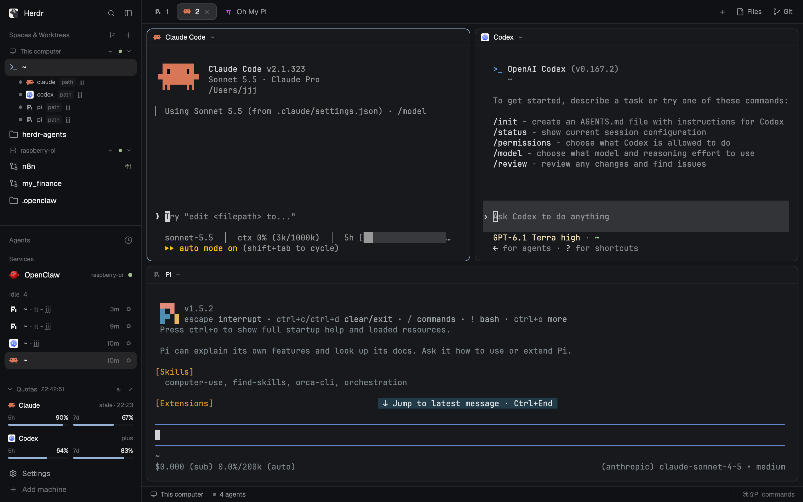

# Herdr Agents

A terminal-focused [Herdr](https://herdr.dev/) layout for working with multiple coding agents. Keep your terminals front and center, see spaces and agent status in the sidebar, and open Files or Git only when you need them.



## Features

- **Spaces and agents:** Browse projects and worktrees with compact icons, and see reported agent states in the sidebar without count badges on space rows.
- **Agent launcher:** The tab-bar **+** menu includes OpenClaw, Oh My Pi (`omp`), and Hermes Agent (`hermes`) alongside Herdr's built-in choices. Availability is checked on the selected space's machine. Available number shortcuts are assigned without renumbering the built-in agents.
- **OpenClaw gateway:** See whether the default gateway is running locally or on a connected remote machine. The service indicator reports gateway availability, not agent activity. Clicking it focuses an identifiable existing foreground OpenClaw process in a Herdr pane, or starts `openclaw` in `~/.openclaw` if none is found. Processes in other terminal applications or hidden inside multiplexers may not be identifiable.
- **On-demand Files and Git:** Open the side panel when needed. Git includes Changes, Graph, PRs, Issues, CI, Review, Pull and Push. Pull is fast-forward-only; Push targets the configured upstream and never force-pushes. The latest Push result can be reopened from its notification detail button.
- **Usage:** View available Claude and Codex quota information. Older Claude observations are labeled stale, expired windows are removed, and stale readings do not trigger quota alerts.
- **Worktree safety:** Automatic worktree cleanup is disabled. Explicit worktree actions can still create or remove worktrees.

## Requirements

- Herdr app with its bundled mods and icons, including `workspace-chrome`, `changes`, and `pane`. Tested with Herdr 0.1.15 on macOS; other platforms have not been fully tested.
- Python 3 and Git for the features that use them. Some integrations also require `gh`, Codex, or `macmon`.
- OpenClaw, Oh My Pi, or Hermes Agent installed on a machine to use the corresponding launcher entry there. OpenClaw launching requires Bash and `openclaw` on that machine's login-shell `PATH`.

## Installation

From this repository's directory, review and run:

```sh
./install.sh
```

The installer copies `layouts/herdr-agents.json` and the included mods into `${HERDR_APP_HOME:-~/.config/herdr-app}`. It checks all destination names first and **refuses to install if any already exist**. It does not overwrite existing layouts or mods, modify `keys.json`, `programs.json` or settings, or switch your active layout. Copying is not transactional: a failure after the preflight can leave a partial installation.

Then check the installed mods and select **herdr-agents** with Herdr's layout switcher:

```sh
for mod in mods/*/; do
  herdr-app check "${HERDR_APP_HOME:-$HOME/.config/herdr-app}/mods/$(basename "$mod")"
done
```

The check loads each mod but does not exercise every dynamic state. Check the layout in the running app as well. If names conflict, follow Herdr's instructions for renaming the new layout or mods and their references; renaming folders alone is not sufficient.

To try the installer without changing your existing configuration, set `HERDR_APP_HOME` to a new empty directory. Herdr's bundled mods must also be present there to use the layout in the app.

### Optional integrations

- **Oh My Pi icon:** To show the logo in Herdr's terminal headers and agent lists, merge [`optional/programs/omp.json`](optional/programs/omp.json) into your existing `~/.config/herdr-app/programs.json`, or create that file if it does not exist. Preserve other entries. The **+** menu logo works without this step.
- **Older Pi versions:** An optional remote-terminal status compatibility extension is documented in [`optional/pi/README.md`](optional/pi/README.md). Do not install it alongside a Pi version with native Herdr status reporting.
- **Claude usage:** Recent quota values can be read from `~/.claude/.statusline.input` when a separately configured Claude Code status line writes `rate_limits` there. This package does not configure or change your status line. The quota panel checks that local input every five seconds for new observations and falls back to the usage endpoint when recent data is unavailable, respecting rate-limit cooldowns. If the endpoint is unavailable, the last valid observation may remain visible for up to six hours, marked stale when appropriate.

The installer does not add the upstream `Ctrl+A` prefix bindings. Review and merge any shortcuts separately if you want them.

## Privacy and network access

Herdr mods can run programs and access files or networks. Review the included code before installing:

- The launcher checks for agent commands in a Bash login shell on the selected machine. OpenClaw gateway checks run every 30 seconds and inspect the service state and current user's process arguments. Clicking its service row inspects Herdr terminal metadata and foreground process arguments to find an existing pane; it does not read terminal contents or messages. Named OpenClaw profiles and Windows service detection are not fully supported.
- Git may automatically fetch a configured upstream while the app is active, even if a previously opened panel is hidden. Explicit actions can push, pull, commit, create or remove worktrees, or interact with GitHub.
- The quota mod reads the local Claude status-line input. Its helper may read local credential and account files, query Codex's app-server, and contact Anthropic's usage endpoint; it stores a cache under `~/.cache/herdr-quota`. Other quota providers may read the local OMP database.
- The system-monitor popup may contact `api.ipify.org`.

Credentials and quota caches are not included in this package. Review your screenshot and all repository contents for private information before sharing.

## Attribution and licenses

Herdr Agents includes adapted third-party code. See [`THIRD-PARTY-NOTICES`](THIRD-PARTY-NOTICES), [`LICENSE`](LICENSE), and [`LICENSE-APACHE-2.0.txt`](LICENSE-APACHE-2.0.txt); individual icon directories may contain additional notices.
